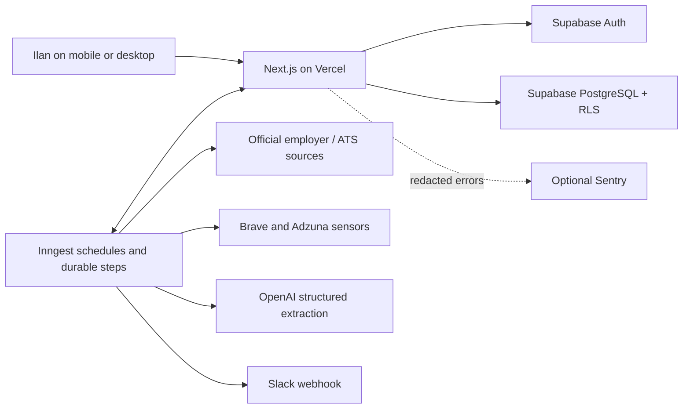
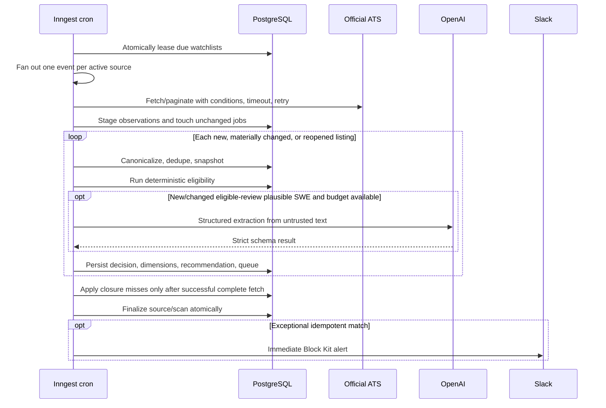

# FirstSeen architecture

## Deployment topology

Next.js owns the authenticated portal, server actions, official Apply redirect, JSON export, and
Inngest serving endpoint. Supabase is authoritative for identity and state. Inngest owns time,
retries, concurrency, partial-failure recovery, and duplicate-safe step replay; Vercel Cron is not
used because its Hobby schedule precision is insufficient. Provider clients are server-only.

## Discovery-to-recommendation flow

Descriptions never travel through orchestration state: the official fetch step stores them as
short-lived observations and returns only observation IDs plus lifecycle identity. Only listings
whose material hash is new/changed, whose policy is stale, or whose official lifecycle has reopened
get independent `step.run` executions. A reopening reuses its validated cached extraction. This
keeps each hosted invocation bounded, avoids unchanged AI cost, and allows a deployment or retry to
resume after the last completed listing.

Broad discovery follows the same authority boundary: sensors return candidate URLs; only supported
official ATS URLs create provisional company/source records and verification events. Sensor text
cannot create a job, eligibility decision, recommendation, or notification.

## Module map

- `src/app`: protected portal routes, Auth UI, server actions, Apply/export APIs, and Inngest route.
- `src/components`: responsive navigation, queue cards/filters/actions, forms, feedback, and states.
- `src/db/schema` and `supabase/migrations`: typed database objects, grants, RLS, indexes, and seed.
- `src/connectors`: connector contract, registry, Greenhouse/Lever/Ashby/JSON-LD implementations,
  unsupported-source policy, and contract fixtures.
- `src/discovery` and `src/lib/discovery`: broad provider normalization, quotas, and official URL
  promotion.
- `src/domain`: pure deterministic eligibility, lifecycle, identity/material hashing, shared
  freshness, company monitoring policy, status transitions, and ranking.
- `src/ai`: versioned prompt, Responses API schema, evidence checks, and token-cost estimation.
- `src/lib/scans`: source loading, pagination, changed-listing staging/processing, and finalization.
- `src/inngest`: cron/event workflows, concurrency, retries, failures, and retention.
- `src/lib/notifications`: Slack formatting, exact-time-zone digest selection, idempotency, quiet
  deferral, and retry.
- `src/lib/http`, `src/lib/security`, `next.config.ts`: SSRF defenses, rate limits, sanitization, and
  browser security headers.

## Durable workflows

| Function              | Trigger                 | Responsibility                                                                           | Retry/isolation                                    |
| --------------------- | ----------------------- | ---------------------------------------------------------------------------------------- | -------------------------------------------------- |
| Watchlist scheduler   | every 15 minutes        | Rebalance only Cold cadence, lease due tiered watches, and fan out active sources        | Conditional lease prevents duplicate schedules     |
| Source scan           | event                   | Start run, official fetch/stage, per-changed-listing processing, closure/finalize, alert | Four retries; concurrency 3/user; one source/event |
| Broad discovery       | minute 17 every 4 hours | Provider sensors, provisional sources, verification fan-out                              | Two retries; singleton                             |
| Notification schedule | minute 0 hourly         | Exact-time digest, deferred alerts, failed delivery retry                                | Three retries; per-user steps                      |
| Retention cleanup     | 03:43 UTC daily         | Expired observations and stale HMAC counters                                             | Two retries                                        |

All workflow identity is derived from stable user/source/scheduled times or snapshot/rule/prompt
versions. Database unique constraints and upserts protect duplicate delivery. Failure handling
records a safe dead letter and marks only the affected source scan failed. Replays use a new event
ID while preserving owner/source validation. No database transaction encloses HTTP or model calls.

Cadence derives from independent interest, active referrals, personal/discovered scope, and a
recent viable recommendation. Priority watches run every 15 minutes, personal Standard and
discovered Warm every 60, and discovered Cold every 240. Dismissal is sticky quarantine. A workload
forecast may lengthen only Cold cadence when protected work plus the catalog would exceed the
configured daily execution budget.

## Authorization and trust boundaries

- The owner enters a four-digit code. Server-side scrypt verification, durable per-address/global
  throttles, and an Auth-admin magic link create a normal Supabase cookie session without sending
  email or storing the plaintext code. `getUser` validates the owner on each protected request; the
  configured owner email remains an independent single-user allowlist.
- Server actions validate form input, require the owner, and scope every lookup/mutation by user.
- RLS provides defense in depth for browser data access. User-owned rows require `auth.uid() =
user_id`; system security counters have no anon/authenticated grants.
- The Supabase secret key and direct database URL exist only in server/deployment environments.
- Outbound URLs permit HTTPS public destinations only. URL parsing, DNS resolution, redirect
  revalidation, private/reserved address rejection, response limits, content checks, timeouts,
  retry/backoff, and per-host pacing mitigate SSRF and resource abuse.
- Job HTML is sanitized/converted to text. Descriptions are delimited as untrusted model data;
  prompts forbid following embedded instructions. Strict schemas and evidence validation reject
  unsupported output. Deterministic code retains final authority.
- Sentry is optional and disabled without DSNs. Request context and exception messages are removed
  before transmission; stacks/types remain useful. Application logs and persisted diagnostics do
  not include provider secrets or raw Auth material.

## Performance, cost, and failure design

Conditional ATS requests, source content metadata, normalized material hashes, changed-only durable
steps, deterministic early exits, compact structured outputs, and provider usage ledgers constrain
work. OpenAI reservations enforce a hard application-level monthly budget before calls. Broad
providers have hard monthly request caps; one provider error is recorded and does not suppress the
other.

### Initial monthly cost model

| Service     |                                       Prototype |                        Reliable production | Control/assumption                                                                                                                                                                                                                                                                             |
| ----------- | ----------------------------------------------: | -----------------------------------------: | ---------------------------------------------------------------------------------------------------------------------------------------------------------------------------------------------------------------------------------------------------------------------------------------------- |
| Vercel      |                                        $0 Hobby | $0 initially; $20 Pro if plan/use requires | Inngest supplies precision schedules; each step stays below Hobby's 60-second function ceiling. [Vercel Hobby](https://vercel.com/docs/plans/hobby) is personal/noncommercial and [Hobby cron](https://vercel.com/docs/cron-jobs/usage-and-pricing) is only daily, so native cron is not used. |
| Supabase    |                  $0 Free if a slot is available |                        $25 Pro recommended | Free has 500 MB database, two active projects, pausing, and no managed backup guarantee; [Pro pricing/backups](https://supabase.com/pricing) provide 8 GB and daily retention.                                                                                                                 |
| Inngest     |                                        $0 Hobby |    $0 expected; Pro starts $99 if exceeded | [Hobby limits](https://www.inngest.com/pricing): 50,000 executions, concurrency 5, 24-hour traces. Changed-only steps and source concurrency protect the allowance.                                                                                                                            |
| Brave       | About $3.60 usage, covered by monthly $5 credit |                                $0 expected | 720 searches × $0.005; 900-request breaker. Re-check [Brave pricing](https://brave.com/search/api/) before cadence increases.                                                                                                                                                                  |
| Adzuna      |                                              $0 |                                $0 expected | 720 requests is below personal API limits; 900-request breaker.                                                                                                                                                                                                                                |
| OpenAI Luna |                                  Usually $2–$12 |                       Hard app ceiling $25 | Changed plausible SWE roles only. At 1,000 analyses averaging 4k input/600 output, Luna rates imply about $7.60; compact outputs, hashing, reservations. [Current model pricing](https://developers.openai.com/api/docs/models) is versioned in code and rechecked before release.             |
| Slack       |                                      $0 webhook |                                $0 expected | One destination; idempotent alerts/digest.                                                                                                                                                                                                                                                     |
| Sentry      |                          $0 Developer, optional |                                $0 expected | Low trace samples and redaction; provider quotas apply. Vercel/Inngest/DB diagnostics are primary.                                                                                                                                                                                             |
| **Total**   |                            **$0 cash expected** |                  **$25/month recommended** | Typical variable usage remains inside credits/free tiers; maximum app-controlled AI spend adds $25. Vercel Pro/Inngest Pro are not initially required.                                                                                                                                         |

Database rows record provider request/token units and estimated/actual cost with idempotency keys.
Spend breakers are independent of provider dashboards and intentionally fail closed into Review or
skip broad discovery rather than producing surprise charges.

Network/model work occurs before or after short database transactions. Source finalization and
closure happen only after all changed listing steps finish. Therefore a partial worker failure
cannot mark unseen jobs closed, and a successful retry safely continues from persisted step and row
identity. Saved/Applied/Dismissed history survives closure.

## Backup, release, and rollback

Migrations are forward-only SQL under `supabase/migrations` and are applied before compatible app
code. Production should use Supabase Pro daily backups; on Free, execute authenticated CLI logical
dumps on a separate durable schedule. Release rollback uses the prior immutable Vercel deployment;
schema changes remain backward compatible for at least one release. Inngest functions use stable
IDs and idempotent row constraints so in-flight runs can finish against either deployment. See
`OPERATIONS.md` for concrete recovery checks.
