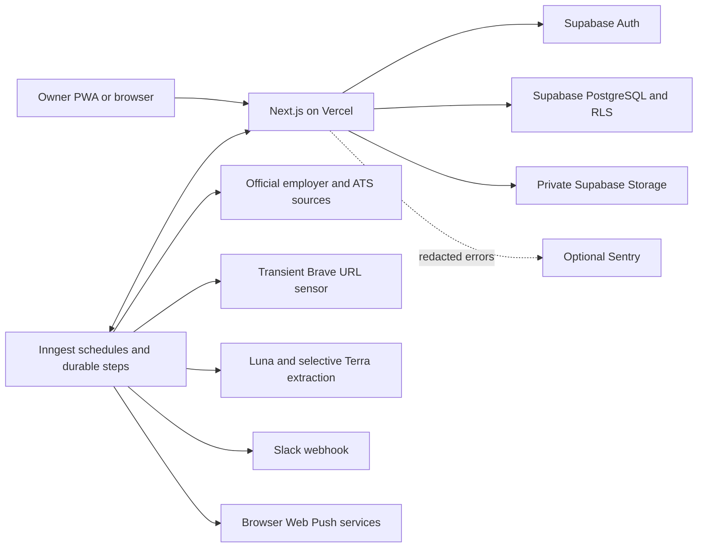
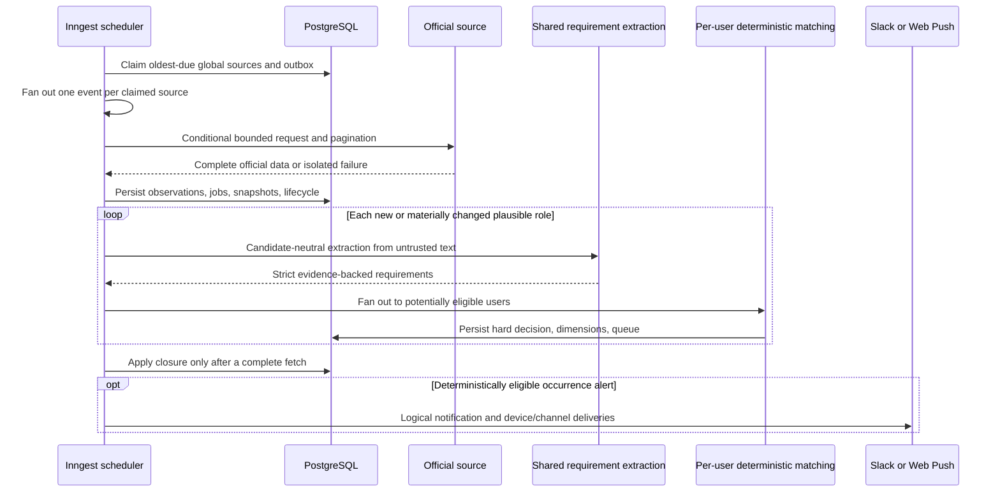

# FirstSeen architecture

## Deployment topology

Next.js owns authenticated UI, server actions, application-session handoff, export, push APIs, PWA
metadata, and the Inngest endpoint. Supabase is authoritative for identity and state. Inngest owns
time, retries, fan-out, partial-failure recovery, and duplicate-safe replay. Provider clients and
private capability keys are server-only.

Supply entities are global and service-managed so one employer source is fetched once. Candidate
profiles, follows, contacts, resumes, eligibility/ranking overlays, queues, applications, and
notification devices are user-private. The global path is additive and feature-flagged during
dual-write/read reconciliation; the legacy source path remains a rollback surface until production
soak finishes.

## Discovery-to-recommendation flow

Descriptions do not travel in orchestration state. Official fetch stores short-lived observations
and returns row identities. Only new/changed snapshots, stale policy versions, or reopenings run
independent durable processing. A reopening can reuse a valid candidate-neutral extraction.

Broad discovery observes the same authority boundary: all twelve role/location cohorts run every
four hours and the active sensor returns transient candidate URLs. Only independently verified ATS
or official structured employer facts enter an event or durable supply. Sensor text cannot create a
job, decision, recommendation, closure, or notification.

## Module map

- `src/app`: protected portal, owner/invite Auth, jobs, People, Applications, Apply/session, push,
  export, offline/manifest, and Inngest routes.
- `src/components`: responsive queue, CRM, application, PWA, push, navigation, and feedback UI.
- `src/db/schema` and `supabase/migrations`: typed objects, grants, RLS, indexes, additive backfill,
  and rollout policy.
- `src/connectors`: safe HTTP and Greenhouse, Lever, Ashby, Recruitee, Pinpoint, and reviewed
  structured connectors with contract fixtures.
- `src/discovery` and `src/lib/discovery`: query cohorts, transient providers, safe redirects,
  organization authority, quotas, and independently verified source registration.
- `src/domain`: deterministic eligibility, ranking, freshness, lifecycle, monitoring, queue,
  relationship, and application policy.
- `src/ai`: candidate-neutral prompts, Responses schema/evidence checks, Luna/Terra routing,
  evaluation metrics, and versioned prices.
- `src/lib/supply`: global ingest, source scheduling/outbox, fan-out, and legacy dual-write.
- `src/lib/notifications`: logical/channel/device orchestration, Slack, encrypted Web Push,
  digest selection, quiet deferral, retry, and expiry.
- `src/connectors/http.ts`, `src/lib/security`, and `next.config.ts`: SSRF/redirect/content-type/size
  defenses, rate limits, capability encryption, sanitization, and security headers.

## Durable workflows

| Function              | Trigger                    | Responsibility                                                                          | Isolation                                  |
| --------------------- | -------------------------- | --------------------------------------------------------------------------------------- | ------------------------------------------ |
| Supply scheduler      | Every 15 minutes           | Claim oldest-due sources and durable outbox; reserve priority capacity                  | Lease/outbox prevents loss and duplication |
| Source scan           | Event                      | Official fetch/stage, changed extraction, user fan-out, closure/finalize, logical alert | One global source per event                |
| Broad discovery       | Minute 17 every four hours | Twelve cohorts, transient sensor, independent official verification                     | Two retries; singleton                     |
| Notification schedule | Minute 0 hourly            | Digest, deferred Slack/push, failed delivery retry                                      | Per logical/channel/device identity        |
| Retention cleanup     | 03:43 UTC daily            | Expired observations, security counters, and bounded cleanup                            | Independently retryable                    |

Workflow identity derives from source/scheduled time, snapshot/rule/prompt versions, logical
notification occurrence, and channel/device. A lease and outbox row are claimed together; expired
leases are reclaimable. Constraints protect duplicate delivery. Failure handling records redacted
diagnostics and fails only the affected source/delivery. HTTP and model calls are never inside a
database transaction.

Notification provider acceptance is separated from database finalization. Exhausted or permanent
failures become owner-scoped redacted dead letters. A stale `sending` claim is an unknown outcome and
is never automatically redelivered; explicit replay provides at-most-once-by-default behavior while
keeping recovery available from Operations.

Priority demand sets source cadence without duplicate fetches. Priority sources run every 15
minutes, Standard/Warm hourly, and Cold every four hours. Dismissal is sticky quarantine. Capacity
forecasting may stop admitting new Cold sources but never silently slows Priority demand.
The global schedule is derived from all active private watches after interest/referral/follow/remove
mutations; the strictest watcher wins and an overdue source remains due.

## Authorization and trust boundaries

- Four-digit owner access uses server-side scrypt, durable address/global throttles, and a normal
  Supabase cookie session. The plaintext code is never stored. Invite-only email foundations are
  disabled by default; open signup stays disabled.
- Every server mutation independently validates and authorizes the user. RLS protects all private
  overlays. Global raw/supply mutation is service-only.
- The Supabase secret key, database URL, VAPID private key, subscription-encryption key, provider
  keys, and Slack webhook are absent from browser bundles.
- Resumes use private Storage, strict file validation, sanitized names, and short-lived signed
  access. Push endpoints/browser keys are encrypted; uniqueness and expiry use endpoint hashes.
- Outbound URLs permit HTTPS public destinations only. DNS and redirects are revalidated; private
  addresses, credentials, non-default ports, loops, disallowed content types, oversized bodies, and
  timeouts fail safely.
- Official HTML and descriptions are untrusted. Content is sanitized and delimited for the model;
  schemas and evidence offsets reject unsupported output. Deterministic code owns hard decisions.
- Default push payloads are generic and contain no contact, referral, resume, weakness, or
  application data.

## Performance, cost, and failure design

Conditional requests, normalized hashes, changed-only processing, deterministic early exits,
compact outputs, and provider ledgers constrain work. OpenAI budget is durably reserved before a
call. Unknown model aliases fail closed. Brave is transient and breaker-limited; Adzuna automated
promotion is disabled.

Current model accounting uses Luna at $0.20/$1.20 and Terra at $2/$12 per million input/output
tokens. At 4,000 input and 600 output tokens with 10% Terra escalation, the planning target is about
$0.003 per analyzed snapshot. The application-level AI ceiling remains $25/month. No paid upgrade
or licensed feed is automatic.

Network/model work occurs around short transactions. Closure happens only after all changed rows
and a complete source result finalize. Partial failure cannot mark unseen jobs closed, and Saved,
Applied, Dismissed, contacts, applications, and history survive lifecycle changes.

## Backup, release, and rollback

Migrations are forward-only and additive. New paths dual-write until counts, hashes, lifecycle,
queue history, and ownership reconcile. Rollback disables the relevant flag and can restore the
prior immutable Vercel deployment; it never destructively reverses schema. A protected logical
backup remains outside the repository and requires an isolated restore test before production
cutover. See `OPERATIONS.md` for the exercised commands and `PLAN.md` for gates not yet claimed.
